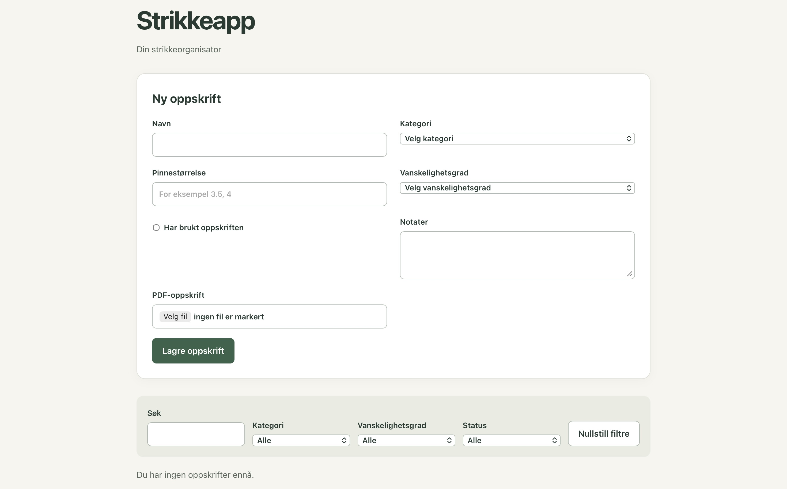
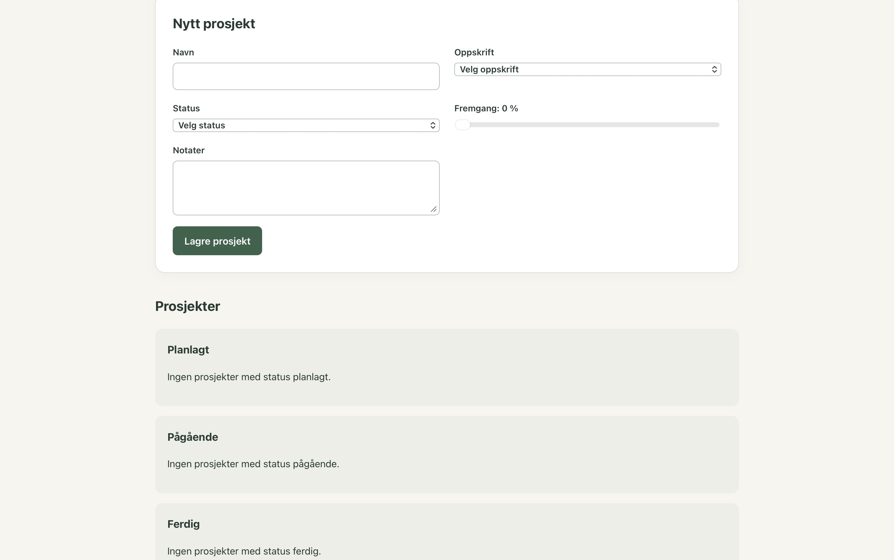

# Strikkeapp

[](https://github.com/marieholen/strikkeapp/actions/workflows/ci.yml)

En lokal strikkeorganisator for å holde oversikt over oppskrifter og strikkeprosjekter.

## Funksjoner

- Opprette og administrere strikkeoppskrifter
- Søke og filtrere oppskrifter
- Laste opp og åpne PDF-oppskrifter
- Opprette og følge opp strikkeprosjekter
- Registrere status og fremgang
- Lagre data lokalt i nettleseren

## Schreenshots
The app is under development. The screenshot shows the recipe library and the form for adding recipes.




## Design

The planned design and prototype are created in Figma. The current interface is an initial version that will be developed further towards this design.

[View the Figma design](https://www.figma.com/design/jytX4we6iirfAwWoAJ3mnB/Strikkeapp)

<!--  -->

## Teknologi

- React
- TypeScript
- Vite
- Vitest
- ESLint
- IndexedDB
- LocalStorage

## Struktur

Prosjektet er organisert etter funksjonalitet:

```text
src/
├── features/
│   ├── recipes/
│   └── projects/
├── test/
├── App.tsx
└── main.tsx
```

Forretningslogikk og validering er separert fra UI-komponentene.

### Lagring

Appen er bygget med en **local-first-arkitektur**:

- Oppskrifter og prosjekter → `localStorage`
- PDF-filer → `IndexedDB`
- Ingen backend eller ekstern database

## Kom i gang

Installer avhengigheter:

```bash
npm install
```

Start utviklingsserveren:

```bash
npm run dev
```

Kjør tester:

```bash
npm test
```

Kjør lint:

```bash
npm run lint
```

Bygg for produksjon:

```bash
npm run build
```

## Status

Kjernefunksjonaliteten for oppskrifter og prosjekter er implementert.

Appen støtter blant annet opprettelse, filtrering, PDF-lagring og oppfølging av strikkeprosjekter.

## Videre utvikling

- Redigere og slette oppskrifter og prosjekter
- Organisere garn og pinner man har
- Mer detaljert prosjektoppfølging
- Forbedret responsivt design
- Flere automatiserte tester
- Mulighet for synkronisering i skyen

## Documentation

See the [contributing document](CONTRIBUTING.md) for the development workflow and language policy.

## AI usage

See the [AI usage](docs/ai-usage.md) for how AI assistance is used and a log of notable use.
