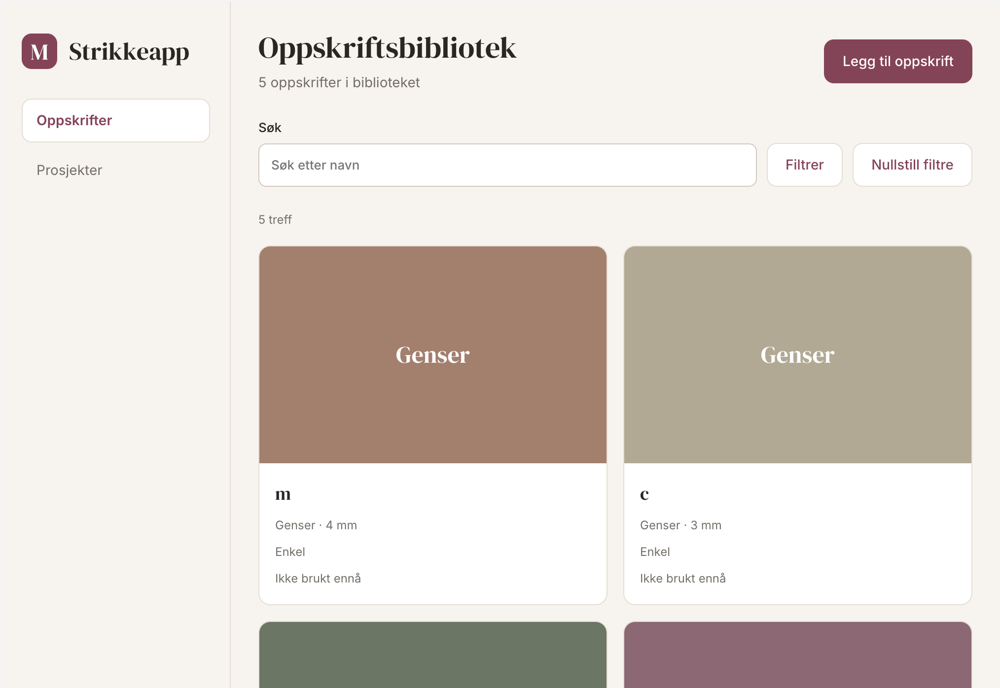
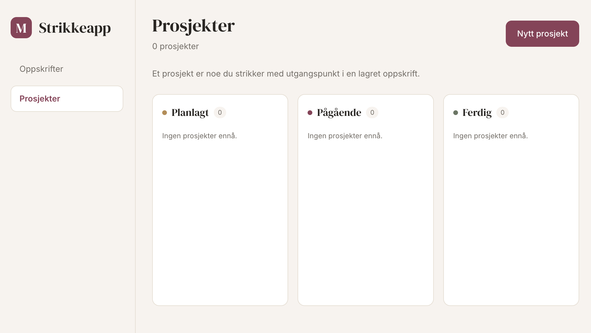
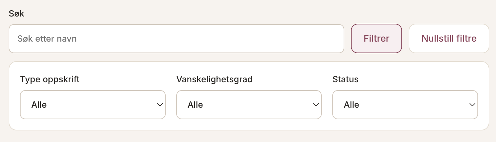
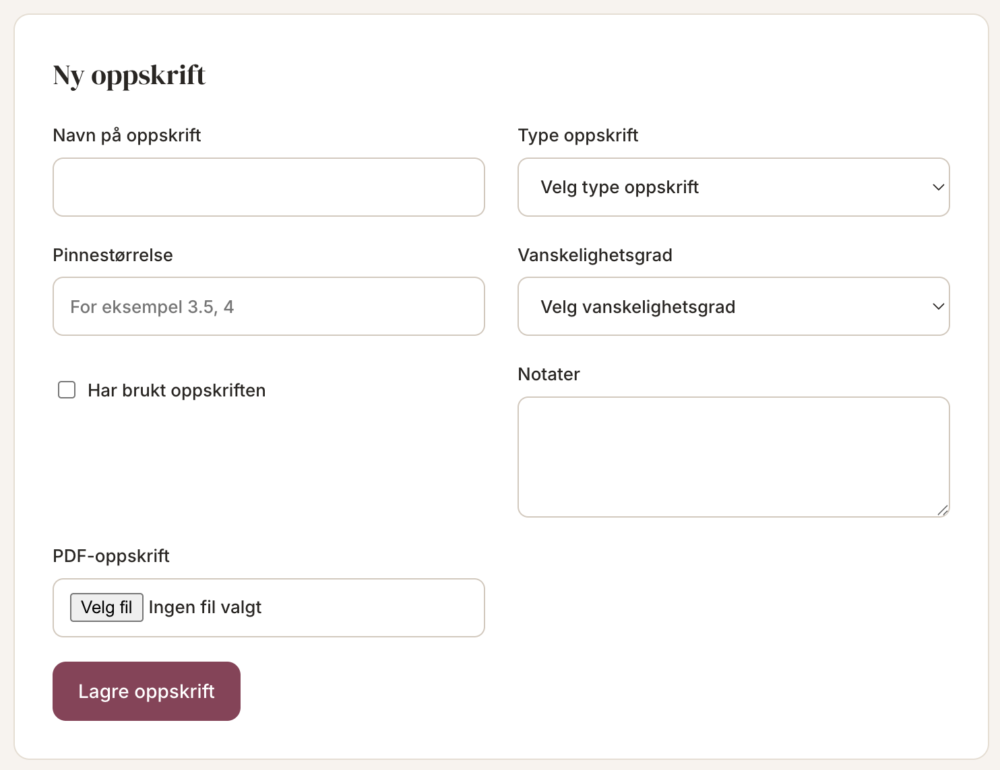
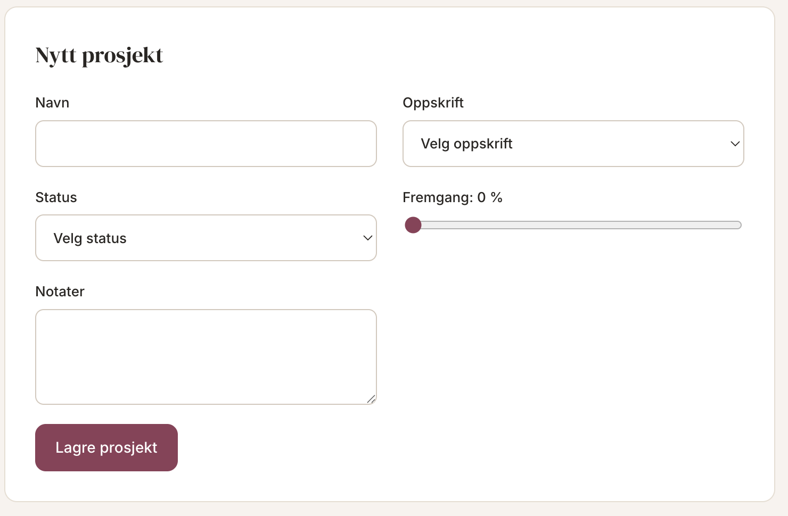

# Strikkeapp

A personal knitting organizer built with React and TypeScript.
I develop this project independently to practise frontend development,
testing and browser-based storage.

## Live demo

[Try Strikkeapp](https://marieholen.github.io/strikkeapp/)

Data and uploaded PDFs are stored locally in your browser.
They are not uploaded to a server or shared with other visitors.

## Features

- Create knitting patterns with notes and an optional PDF
- Open a pattern detail view with notes and written instructions
- Search and filter saved patterns
- Open saved PDFs in a new browser tab
- Create projects linked to a saved pattern
- Choose a status and progress when creating a project
- View projects grouped by status
- Store patterns, projects and PDFs locally

## Screenshots

### Recipe library



### Projects



<details>
<summary>More screenshots</summary>

### Filter bar



### New recipe form



### New project form



</details>

## Using the app

Use the navigation to switch between recipes and projects.
The navigation appears in a sidebar on desktop and at the bottom on mobile.

### Recipes

The recipe library displays saved patterns as cards.
Select **Åpne** to read the details, notes and written instructions.
Line breaks in notes are preserved. Select **Åpne PDF** to open an attached PDF.
Use **Tilbake** to return with your filters and unsaved input kept.
Detail links can be opened directly and reloaded in the same browser.
An unknown recipe link shows a message and a link back to the library.

Select **Legg til oppskrift** to open the form.
Use **Lukk oppskriftsskjema** to close it.
Closing and reopening the form keeps unsaved input.

While saving, the recipe form is disabled and the button shows **Lagrer...**.
The whole form, including the selected PDF, clears after successful saving.
If saving fails, an error is shown and the input is kept for another attempt.
An invalid PDF must be removed or replaced before saving.

Use the search field to find patterns by name.
Select **Filtrer** to show or hide the other filters.
Selected filters remain active when the controls are hidden.
Select **Nullstill filtre** to clear the search and filters.

### Projects

A project represents something you are knitting from a saved pattern.
The same pattern can be used for several projects.

Select **Nytt prosjekt** to open the project form.
Projects are displayed in groups based on their status.

Unsaved form input is kept when closing a form or switching between pages.
It is not preserved after reloading or closing the app.

## Design

The recipe and project pages are based on the Figma design.
The current version includes responsive navigation, recipe cards,
project columns and forms that open when needed.

Some screens and features in Figma are planned for later development.
Recipe cards currently use colored placeholders instead of uploaded photos.

[View the Figma design](https://www.figma.com/design/jytX4we6iirfAwWoAJ3mnB/Strikkeapp)

## Technology

- React
- TypeScript
- Vite
- Vitest and React Testing Library
- ESLint and Prettier
- IndexedDB
- localStorage

The interface uses Inter and DM Serif Display from Google Fonts.
Local fallback fonts are used if they cannot be loaded.

## Structure

The project is organized by feature:

```text
src/
├── features/
│   ├── recipes/
│   └── projects/
├── test/
├── App.tsx
└── main.tsx
```

Business logic and validation are separated from UI components.

### Storage

- Pattern and project data is stored in localStorage
- PDF files are stored in IndexedDB
- The app has no backend or external database

Data belongs to the browser and device where it was created.
Clearing browser data can remove saved content.
Private browsing storage may be removed when the private session ends.
The app does not currently provide backups or synchronization.

## Getting started

Install dependencies:

```bash
npm install
```

Start the development server:

```bash
npm run dev
```

## Checks

Run automated tests:

```bash
npm test
```

Check TypeScript:

```bash
npm run typecheck
```

Run lint checks:

```bash
npm run lint
```

Check formatting:

```bash
npm run format:check
```

Build for production:

```bash
npm run build
```

## Future development

- Edit and delete patterns and projects
- Update project status and progress
- Read and annotate PDFs inside the app
- Manage yarn and needle inventory
- Add photos and more detailed project information

## Documentation

See the [contribution guidelines](CONTRIBUTING.md) for the development
workflow and language policy.

## AI usage

See the [AI usage documentation](docs/ai-usage.md) for how
AI assistance is used and reviewed in this project.
